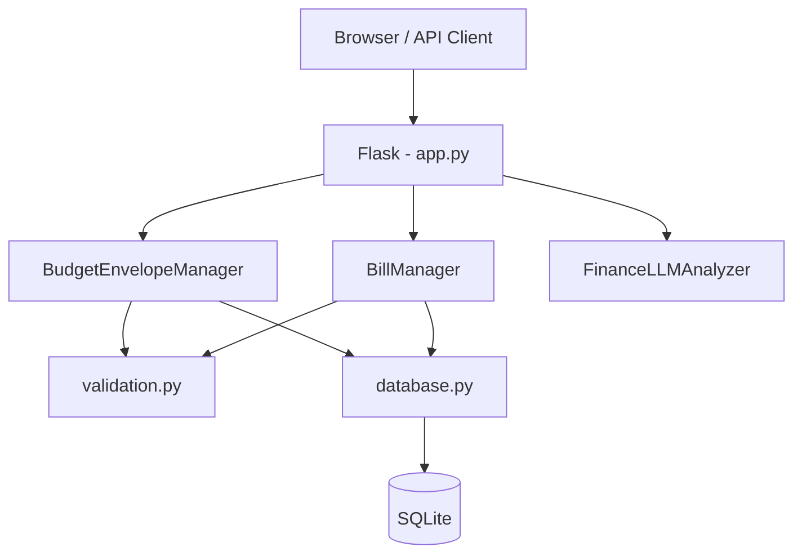
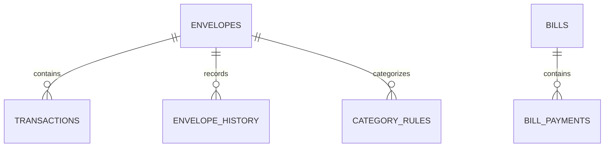

# Personal Finance Tracker

A Flask-based personal finance management application combining
envelope budgeting, recurring bill tracking and rule-based financial
analysis.

The application is designed as a modular monolith with two independent
financial domains, allowing future migration to microservices.

## Features

### Domain A: Envelope Budgeting

- Create and manage budget envelopes.
- Set monthly budget allocations.
- Allocate funds and record spending transactions.
- Stop rule: prevents spending beyond the available balance.
- Borrow rule: permits negative balances.
- Monthly rollover with historical records.
- Protection against repeated rollover within the same month.
- Automatic transaction categorization based on merchant patterns.
- Input validation and appropriate HTTP error responses.

### Domain B: Bill and Subscription Tracking

- Create recurring bills and subscriptions.
- Track payment status and payment history.
- Automatically advance due dates after payment.
- Project upcoming bill occurrences.
- Deactivate recurring bills while preserving payment history.
- Validate amounts, frequencies and due dates.

### Additional Features

- Web-based financial dashboard.
- Simulated bank transaction API.
- Rule-based financial question answering and insights.
- Persistent SQLite storage.
- Automated database initialization and legacy data repairs.
- Automated unit, regression and integration tests.

## Technology Stack

- Python 3.11
- Flask 3.0
- SQLite
- HTML, CSS and vanilla JavaScript
- python-dateutil
- Python unittest
- coverage.py for development testing

## Installation

### Prerequisites

- Python 3.11
- pip
- Git

### Clone the repository

```bash
git clone https://github.com/Harim2006/finance_tracker.git
cd finance_tracker
```

### Create a virtual environment

```bash
python -m venv .venv
```

Windows PowerShell:

```powershell
.\.venv\Scripts\Activate.ps1
```

If PowerShell blocks activation scripts, run:

```powershell
Set-ExecutionPolicy -Scope Process -ExecutionPolicy Bypass
.\.venv\Scripts\Activate.ps1
```

Linux/macOS:

```bash
source .venv/bin/activate
```

### Install dependencies

```bash
python -m pip install -r requirements.txt
```

### Start the application

```bash
python app.py
```

Open http://localhost:5000 in your browser.

The database is initialized automatically. Sample data is
created when the database is initially empty.

## Environment Variables

| Variable | Default | Purpose |
|----------|---------|---------|
| PORT | 5000 | HTTP listening port |
| DATA_DIR | ./data | SQLite database directory |

Example configuration in Windows PowerShell:

```powershell
$env:PORT = "8080"
$env:DATA_DIR = "./data"
python app.py
```

Example configuration in Linux/macOS:

```bash
PORT=8080 DATA_DIR=./data python app.py
```

The application binds to 0.0.0.0 and stores its database at
DATA_DIR/finance.db.

The data directory must be writable and persistent across
application restarts.

## Architecture

The application uses a modular monolithic architecture.



The two financial domains do not import each other directly.

Shared infrastructure handles database connections and
reusable validation.

## Database Design



Budget domain tables:

- envelopes
- transactions
- envelope_history
- category_rules

Bill domain tables:

- bills
- bill_payments

No foreign keys connect the two financial domains.

## API Endpoints

| Method | Endpoint | Purpose |
|--------|----------|---------|
| GET | / | Dashboard |
| GET | /envelopes | List envelopes |
| POST | /envelopes/create | Create envelope |
| POST | /envelopes/{id}/allocate | Allocate funds |
| POST | /envelopes/{id}/spend | Record spending |
| POST | /envelopes/rollover | Execute monthly rollover |
| GET | /bills | List active bills |
| POST | /bills/create | Create recurring bill |
| POST | /bills/{id}/pay | Record payment |
| POST | /bills/{id}/deactivate | Deactivate bill |
| GET | /bills/upcoming?months=3 | Project bill occurrences |
| POST | /api/bank/transaction | Import simulated purchase |
| POST | /simulate-purchase | Simulate purchase |
| GET | /api/dashboard/summary | Dashboard statistics |
| GET | /analysis/insights | Financial insights |

The table lists the principal verified endpoints.

### HTTP Error Handling

- 400: Invalid or missing input.
- 404: Requested resource does not exist.
- 409: Conflicting operation, duplicate envelope or blocked overdraft.

## Running Tests

Run the complete automated test suite:

```bash
python -m unittest discover -v
```

Install the development coverage tool:

```bash
python -m pip install coverage
```

Measure application statement coverage:

```bash
python -m coverage erase
python -m coverage run --source=budget_domain,bill_domain,database,validation,app,llm_analyzer -m unittest discover -v
python -m coverage report -m
```

Generate an HTML coverage report:

```bash
python -m coverage html
```

Open htmlcov/index.html in a browser.

### Verified Test Results

Corrective iteration: November 25, 2026.

- Total tests: 105
- Passed: 105
- Failures: 0
- Errors: 0
- Overall statement coverage: 93.38%

| Module | Statement Coverage |
|--------|-------------------|
| app.py | 86% |
| budget_domain.py | 98% |
| bill_domain.py | 88% |
| database.py | 96% |
| llm_analyzer.py | 100% |
| validation.py | 97% |

Tests use temporary databases to isolate test data from
the application's persistent financial records.

Statement coverage measures executed code and does not
guarantee that all possible edge cases have been tested.

## Project Structure

```text
finance_tracker/
├── app.py
├── budget_domain.py
├── bill_domain.py
├── database.py
├── validation.py
├── llm_analyzer.py
├── templates/
│   ├── base.html
│   ├── index.html
│   ├── envelope.html
│   └── bills.html
├── test_app.py
├── test_budget_domain.py
├── test_bill_domain.py
├── test_database.py
├── test_llm_analyzer.py
├── requirements.txt
├── README.md
├── ADR.md
├── AI_USAGE.md
└── .gitignore
```

## Deployment Baseline

- Runs as a single application process.
- Binds to 0.0.0.0.
- Reads the listening port from PORT.
- Uses DATA_DIR for persistent storage.
- Initializes its SQLite schema automatically.
- Installs runtime dependencies from requirements.txt.
- Does not require an external database server.
- Does not require an external LLM API or API key.

The application currently uses the Flask development server.
Production server configuration, containerization and cloud
deployment are subsequent deployment tasks.

## Known Limitations

- Single-user application without authentication.
- Simulated bank integration rather than real banking services.
- Rule-based financial analyzer rather than a trained LLM.
- SQLite is intended for a lightweight, single-instance deployment.
- Financial recommendations are simplified and illustrative.

## Project Documentation

- ADR.md: Architecture decision records.
- AI_USAGE.md: AI assistance disclosure and interaction history.

## Corrective Iteration

Following Assignment 1 feedback, the application was revised
to correct bill recurrence, payment processing, monthly
rollover, template rendering, validation and HTTP error
handling.

Domain boundaries were strengthened, internal HTTP self-calls
were removed, and automated tests were expanded from 21 to 105.

The corrected application provides the baseline for the
subsequent deployment assignment.
