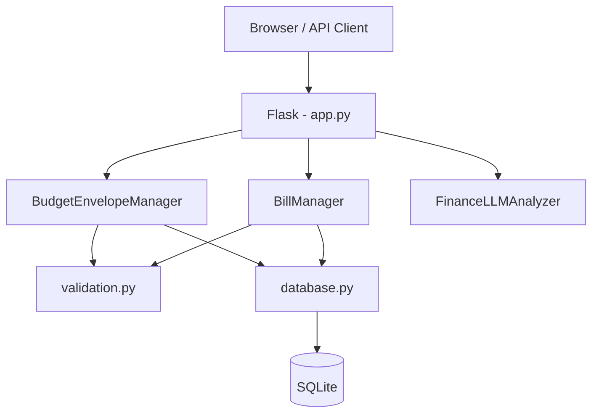
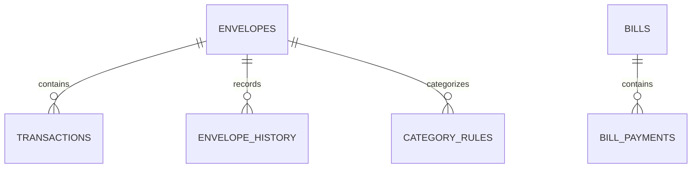

# Personal Finance Tracker

A Flask-based personal finance management application combining
envelope budgeting, recurring bill tracking and rule-based financial
analysis.

The application is designed as a modular monolith with two independent
financial domains, allowing future migration to microservices.

## Features

### Domain A: Envelope Budgeting

- Create and manage budget envelopes.
- Set monthly budget allocations.
- Allocate funds and record spending transactions.
- Stop rule: prevents spending beyond the available balance.
- Borrow rule: permits negative balances.
- Monthly rollover with historical records.
- Protection against repeated rollover within the same month.
- Automatic transaction categorization based on merchant patterns.
- Input validation and appropriate HTTP error responses.

### Domain B: Bill and Subscription Tracking

- Create recurring bills and subscriptions.
- Track payment status and payment history.
- Automatically advance due dates after payment.
- Project upcoming bill occurrences.
- Deactivate recurring bills while preserving payment history.
- Validate amounts, frequencies and due dates.

### Additional Features

- Web-based financial dashboard.
- Simulated bank transaction API.
- Rule-based financial question answering and insights.
- Persistent SQLite storage.
- Automated database initialization and legacy data repairs.
- Automated unit, regression and integration tests.

## Technology Stack

- Python 3.11
- Flask 3.0
- SQLite
- HTML, CSS and vanilla JavaScript
- python-dateutil
- Python unittest
- coverage.py for development testing

## Installation

### Prerequisites

- Python 3.11
- pip
- Git

### Clone the repository

```bash
git clone https://github.com/Harim2006/finance_tracker.git
cd finance_tracker
```

### Create a virtual environment

```bash
python -m venv .venv
```

Windows PowerShell:

```powershell
.\.venv\Scripts\Activate.ps1
```

If PowerShell blocks activation scripts, run:

```powershell
Set-ExecutionPolicy -Scope Process -ExecutionPolicy Bypass
.\.venv\Scripts\Activate.ps1
```

Linux/macOS:

```bash
source .venv/bin/activate
```

### Install dependencies

```bash
python -m pip install -r requirements.txt
```

### Start the application

```bash
python app.py
```

Open http://localhost:5000 in your browser.

The database is initialized automatically. Sample data is
created when the database is initially empty.

## Environment Variables

| Variable | Default | Purpose |
|----------|---------|---------|
| PORT | 5000 | HTTP listening port |
| DATA_DIR | ./data | SQLite database directory |

Example configuration in Windows PowerShell:

```powershell
$env:PORT = "8080"
$env:DATA_DIR = "./data"
python app.py
```

Example configuration in Linux/macOS:

```bash
PORT=8080 DATA_DIR=./data python app.py
```

The application binds to 0.0.0.0 and stores its database at
DATA_DIR/finance.db.

The data directory must be writable and persistent across
application restarts.

## Architecture

The application uses a modular monolithic architecture.



The two financial domains do not import each other directly.

Shared infrastructure handles database connections and
reusable validation.

## Database Design



Budget domain tables:

- envelopes
- transactions
- envelope_history
- category_rules

Bill domain tables:

- bills
- bill_payments

No foreign keys connect the two financial domains.

## Assignment 1 API Endpoints

| Method | Endpoint | Purpose |
|--------|----------|---------|
| GET | / | Dashboard |
| GET | /envelopes | List envelopes |
| POST | /envelopes/create | Create envelope |
| POST | /envelopes/{id}/allocate | Allocate funds |
| POST | /envelopes/{id}/spend | Record spending |
| POST | /envelopes/rollover | Execute monthly rollover |
| GET | /bills | List active bills |
| POST | /bills/create | Create recurring bill |
| POST | /bills/{id}/pay | Record payment |
| POST | /bills/{id}/deactivate | Deactivate bill |
| GET | /bills/upcoming?months=3 | Project bill occurrences |
| POST | /api/bank/transaction | Import simulated purchase |
| POST | /simulate-purchase | Simulate purchase |
| GET | /api/dashboard/summary | Dashboard statistics |
| GET | /analysis/insights | Financial insights |

The table lists the principal verified endpoints.

### HTTP Error Handling

- 400: Invalid or missing input.
- 404: Requested resource does not exist.
- 409: Conflicting operation, duplicate envelope or blocked overdraft.

## Running Tests

Install the test dependencies and run the complete automated suite.

```bash
python -m pip install -r requirements-test.txt
python -m unittest discover -v
```

Install the development coverage tool:

```bash
python -m pip install coverage
```

Measure application statement coverage:

```bash
python -m coverage erase
python -m coverage run --source=budget_domain,bill_domain,database,validation,app,llm_analyzer -m unittest discover -v
python -m coverage report -m
```

Generate an HTML coverage report:

```bash
python -m coverage html
```

Open htmlcov/index.html in a browser.

### Assignment 1 Verified Test Results

Corrective iteration: November 25, 2026.

- Total tests: 105
- Passed: 105
- Failures: 0
- Errors: 0
- Overall statement coverage: 93.38%

| Module | Statement Coverage |
|--------|-------------------|
| app.py | 86% |
| budget_domain.py | 98% |
| bill_domain.py | 88% |
| database.py | 96% |
| llm_analyzer.py | 100% |
| validation.py | 97% |

Tests use temporary databases to isolate test data from
the application's persistent financial records.

Statement coverage measures executed code and does not
guarantee that all possible edge cases have been tested.

## Project Structure

```text
finance_tracker/
├── app.py
├── budget_domain.py
├── bill_domain.py
├── database.py
├── validation.py
├── llm_analyzer.py
├── templates/
│   ├── base.html
│   ├── index.html
│   ├── envelope.html
│   └── bills.html
├── test_app.py
├── test_budget_domain.py
├── test_bill_domain.py
├── test_database.py
├── test_llm_analyzer.py
├── requirements.txt
├── README.md
├── ADR.md
├── AI_USAGE.md
└── .gitignore
```

## Deployment Baseline

- Runs as a single application process.
- Binds to 0.0.0.0.
- Reads the listening port from PORT.
- Uses DATA_DIR for persistent storage.
- Initializes its SQLite schema automatically.
- Installs runtime dependencies from requirements.txt.
- Does not require an external database server.
- Does not require an external LLM API or API key.

The application currently uses the Flask development server.
Production server configuration, containerization and cloud
deployment are subsequent deployment tasks.

## Known Limitations

- Single-user application without authentication.
- Simulated bank integration rather than real banking services.
- Rule-based financial analyzer rather than a trained LLM.
- SQLite is intended for a lightweight, single-instance deployment.
- Financial recommendations are simplified and illustrative.

## Project Documentation

- ADR.md: Architecture decision records.
- AI_USAGE.md: AI assistance disclosure and interaction history.

## Corrective Iteration

Following Assignment 1 feedback, the application was revised
to correct bill recurrence, payment processing, monthly
rollover, template rendering, validation and HTTP error
handling.

Domain boundaries were strengthened, internal HTTP self-calls
were removed, and automated tests were expanded from 21 to 105.

The corrected application provides the baseline for the
subsequent deployment assignment.

## Assignment 2 Static Frontend

The Assignment 2 frontend is an independent static site in [`ui/`](ui/). It
uses vanilla HTML, CSS and JavaScript and calls the Budget Service on port 5001
and the Bills Service on port 5002 directly from the browser. It does not add
another application backend or access SQL Server directly.

For local development, start the complete delivery with Docker Compose:

```powershell
docker compose up -d --build
```

Open <http://localhost:8080>. Nginx serves the static files and reverse-proxies
same-origin `/api/budget/*` and `/api/bills/*` requests to the two backend
containers. Docker service names are used only inside the Compose network and
are never exposed to browser JavaScript. No third application backend is
created.

For standalone static development, serve `ui/` on another port and use the
direct API origins in [`ui/config.js`](ui/config.js):

```powershell
python -m http.server 8081 --directory ui
```

The Compose image replaces that file with [`ui/config.compose.js`](ui/config.compose.js)
so the container uses the Nginx proxy paths. For Azure Storage Static Website
deployment, provide the public Budget and Bills API origins in the deployed
configuration and set each API's `UI_ORIGIN` to the static site's HTTPS origin.
The APIs restrict CORS responses to that origin when called directly.

The host port bindings can be remapped for isolated verification with
`SQLSERVER_HOST_PORT`, `BUDGET_HOST_PORT`, `BILLS_HOST_PORT`, and
`UI_HOST_PORT`; their defaults remain 1433, 5001, 5002, and 8080.

The static UI preserves the original workflows: dashboard summaries, envelope
creation/allocation/spending, monthly rollover, simulated purchases, recurring
bill creation, payments, deactivation, and financial questions/insights.

## Azure SQL compatibility and resilience

The backend services use `DATABASE_URL` as their primary deployment contract.
The URL format is:

```text
mssql://<url-encoded-user>:<url-encoded-password>@<server>.database.windows.net:1433/<database>?encrypt=true&trustservercertificate=false
```

The `pymssql` 2.4.6 driver maps `encrypt=true` to its supported
`encryption="required"` connection option. Certificate-bypass URLs are
rejected. Docker Compose remains backward compatible with its existing
`DB_HOST`, `DB_PORT`, `DB_NAME`, `DB_USER`, and `DB_PASSWORD` variables when
`DATABASE_URL` is not set.

The local Compose database path remains `db/init.py`, which uses the local SQL
Server administrator and server-level logins. Azure SQL uses the separate
`db/azure_init.py` path against already-provisioned databases. It connects to
each database independently as an administrator, creates one contained user if
needed, and grants only `db_ddladmin`, `db_datareader`, and `db_datawriter` in
that database. It does not use `sa`, `CREATE LOGIN`, or cross-database `USE`.

For Azure initialization, provide the following only through a secure runtime
or CI environment; do not commit them:

```text
AZURE_BUDGET_ADMIN_DATABASE_URL
AZURE_BUDGET_DB_USER
AZURE_BUDGET_DB_PASSWORD
AZURE_BILLS_ADMIN_DATABASE_URL
AZURE_BILLS_DB_USER
AZURE_BILLS_DB_PASSWORD
```

The migration runner preserves the existing transactional tracking table and
skip behavior. For independent Azure migration connections, set
`BUDGET_MIGRATION_DATABASE_URL` and `BILLS_MIGRATION_DATABASE_URL` to the
appropriate service-specific URLs and invoke `db/migrate.py` explicitly. If
they are absent, the existing local administrator migration configuration is
used. Migrations are not run by either web service and are never retried after
a commit has started.

Web-service connection establishment retries only known transient failures,
including Azure SQL serverless cold-start codes 40613 and 40197, with bounded
exponential backoff. Authentication and configuration failures are not retried.
Health continues to return HTTP 503 when the database is unavailable. The
static UI retries only read-only GET requests for transient 502/503/504 or
network failures; financial write requests are never automatically retried.

## Assignment 2 API contracts

| Service | OpenAPI 3.0.3 document | Local base URL | Operations |
|---------|------------------------|----------------|------------|
| Budget | [services/budget/openapi.yaml](services/budget/openapi.yaml) | `http://localhost:5001` | 14 |
| Bills | [services/bills/openapi.yaml](services/bills/openapi.yaml) | `http://localhost:5002` | 10 |

The operation counts cover the explicit Flask GET and POST routes. Flask
also handles HEAD for GET routes and OPTIONS for browser preflight. Both
services return `status`, `db`, and `version` from `GET /health`. The
database readiness probe returns 200 when ready and 503 when it fails.
The Budget dashboard calls `GET /bills/due?days=30`. Budget financial
questions and insights call `GET /bills`. A failure of either required Bills
call is reported as a 503 JSON error by Budget.

### Step 22 verification (November 27, 2026)

The complete Python suite passed all **137 tests**, including 24 contract
tests. The contract suite parses the YAML, validates the OpenAPI documents
and their JSON examples, checks both Flask route maps, and validates
Flask test-client responses using SQL cursor and outbound HTTP fixtures.
Python 3.11 and `requirements-test.txt` provide the test environment for CI.

The standalone OpenAPI validation, all three JavaScript syntax checks, and
the Compose configuration check also passed.

```bash
python -m openapi_spec_validator services/budget/openapi.yaml services/bills/openapi.yaml
node --check ui/app.js
node --check ui/config.js
node --check ui/config.compose.js
docker compose config --quiet
```

Live Compose smoke tests checked both direct backend ports, both Nginx
health proxies, the UI homepage, and JSON POST preflights. Live success
and validation-error responses matched the documented schemas. SQL Server,
Budget, and Bills were healthy, and `db-init` exited with code 0.

### Findings from the frontend and API review

The frontend's request paths, methods, and JSON field names match the
service routes. The review found differences in validation and display.

- A simulated purchase can return 200 with `status: uncategorized` and
  create no transaction. The UI reports “Purchase recorded” for that response.
- The bill form accepts due days 1–31 for every frequency. The API caps
  weekly and biweekly at 7 and 14 and allows quarterly and yearly up to 90
  and 365 respectively.
- The dashboard's “Bills due in 30 days” total includes overdue active bills.
- A spending-breakdown date that SQL Server cannot parse returns 503 with
  `{"error":"Database unavailable"}`. Certain wrong-type values, such as a
  non-string financial question or array-valued bill frequency, can return
  a Flask HTML 500 response.
