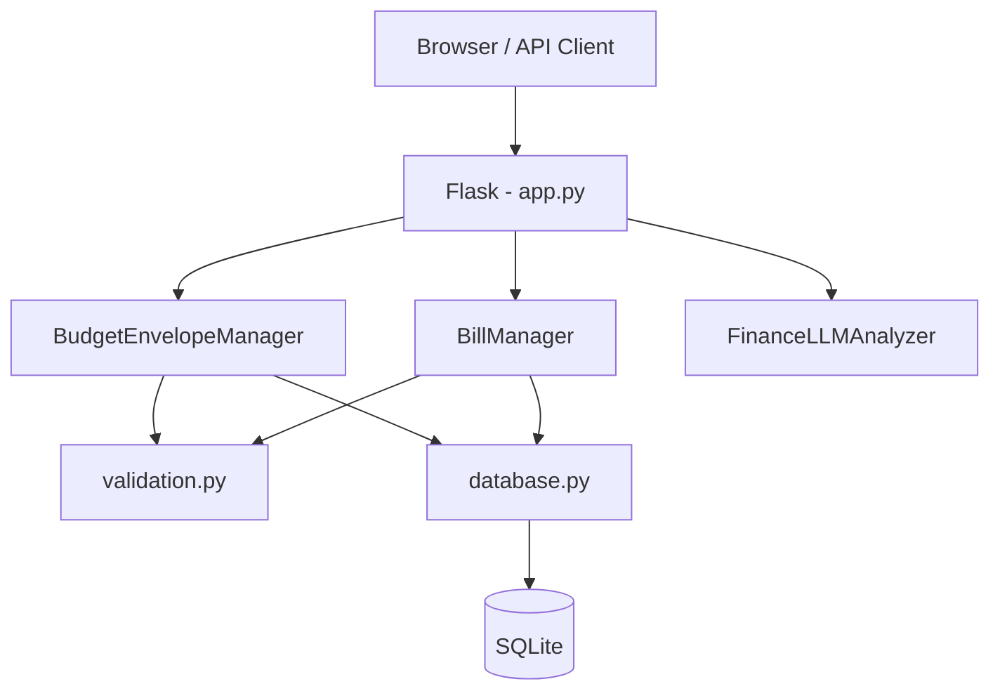
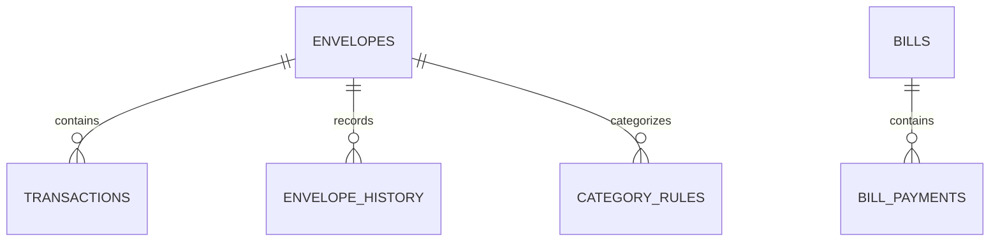

# Personal Finance Tracker

A Flask-based personal finance management application combining
envelope budgeting, recurring bill tracking and rule-based financial
analysis.

The application is designed as a modular monolith with two independent
financial domains, allowing future migration to microservices.

## Features

### Domain A: Envelope Budgeting

- Create and manage budget envelopes.
- Set monthly budget allocations.
- Allocate funds and record spending transactions.
- Stop rule: prevents spending beyond the available balance.
- Borrow rule: permits negative balances.
- Monthly rollover with historical records.
- Protection against repeated rollover within the same month.
- Automatic transaction categorization based on merchant patterns.
- Input validation and appropriate HTTP error responses.

### Domain B: Bill and Subscription Tracking

- Create recurring bills and subscriptions.
- Track payment status and payment history.
- Automatically advance due dates after payment.
- Project upcoming bill occurrences.
- Deactivate recurring bills while preserving payment history.
- Validate amounts, frequencies and due dates.

### Additional Features

- Web-based financial dashboard.
- Simulated bank transaction API.
- Rule-based financial question answering and insights.
- Persistent SQLite storage.
- Automated database initialization and legacy data repairs.
- Automated unit, regression and integration tests.

## Technology Stack

- Python 3.11
- Flask 3.0
- SQLite
- HTML, CSS and vanilla JavaScript
- python-dateutil
- Python unittest
- coverage.py for development testing

## Installation

### Prerequisites

- Python 3.11
- pip
- Git

### Clone the repository

```bash
git clone https://github.com/Harim2006/finance_tracker.git
cd finance_tracker
```

### Create a virtual environment

```bash
python -m venv .venv
```

Windows PowerShell:

```powershell
.\.venv\Scripts\Activate.ps1
```

If PowerShell blocks activation scripts, run:

```powershell
Set-ExecutionPolicy -Scope Process -ExecutionPolicy Bypass
.\.venv\Scripts\Activate.ps1
```

Linux/macOS:

```bash
source .venv/bin/activate
```

### Install dependencies

```bash
python -m pip install -r requirements.txt
```

### Start the application

```bash
python app.py
```

Open http://localhost:5000 in your browser.

The database is initialized automatically. Sample data is
created when the database is initially empty.

## Environment Variables

| Variable | Default | Purpose |
|----------|---------|---------|
| PORT | 5000 | HTTP listening port |
| DATA_DIR | ./data | SQLite database directory |

Example configuration in Windows PowerShell:

```powershell
$env:PORT = "8080"
$env:DATA_DIR = "./data"
python app.py
```

Example configuration in Linux/macOS:

```bash
PORT=8080 DATA_DIR=./data python app.py
```

The application binds to 0.0.0.0 and stores its database at
DATA_DIR/finance.db.

The data directory must be writable and persistent across
application restarts.

## Architecture

The application uses a modular monolithic architecture.



The two financial domains do not import each other directly.

Shared infrastructure handles database connections and
reusable validation.

## Database Design



Budget domain tables:

- envelopes
- transactions
- envelope_history
- category_rules

Bill domain tables:

- bills
- bill_payments

No foreign keys connect the two financial domains.

## Assignment 1 API Endpoints

| Method | Endpoint | Purpose |
|--------|----------|---------|
| GET | / | Dashboard |
| GET | /envelopes | List envelopes |
| POST | /envelopes/create | Create envelope |
| POST | /envelopes/{id}/allocate | Allocate funds |
| POST | /envelopes/{id}/spend | Record spending |
| POST | /envelopes/rollover | Execute monthly rollover |
| GET | /bills | List active bills |
| POST | /bills/create | Create recurring bill |
| POST | /bills/{id}/pay | Record payment |
| POST | /bills/{id}/deactivate | Deactivate bill |
| GET | /bills/upcoming?months=3 | Project bill occurrences |
| POST | /api/bank/transaction | Import simulated purchase |
| POST | /simulate-purchase | Simulate purchase |
| GET | /api/dashboard/summary | Dashboard statistics |
| GET | /analysis/insights | Financial insights |

The table lists the principal verified endpoints.

### HTTP Error Handling

- 400: Invalid or missing input.
- 404: Requested resource does not exist.
- 409: Conflicting operation, duplicate envelope or blocked overdraft.

## Running Tests

Install the test dependencies and run the complete automated suite.

```bash
python -m pip install -r requirements-test.txt
python -m unittest discover -v
```

Install the development coverage tool:

```bash
python -m pip install coverage
```

Measure application statement coverage:

```bash
python -m coverage erase
python -m coverage run --source=budget_domain,bill_domain,database,validation,app,llm_analyzer -m unittest discover -v
python -m coverage report -m
```

Generate an HTML coverage report:

```bash
python -m coverage html
```

Open htmlcov/index.html in a browser.

### Assignment 1 Verified Test Results

Corrective iteration: November 25, 2026.

- Total tests: 105
- Passed: 105
- Failures: 0
- Errors: 0
- Overall statement coverage: 93.38%

| Module | Statement Coverage |
|--------|-------------------|
| app.py | 86% |
| budget_domain.py | 98% |
| bill_domain.py | 88% |
| database.py | 96% |
| llm_analyzer.py | 100% |
| validation.py | 97% |

Tests use temporary databases to isolate test data from
the application's persistent financial records.

Statement coverage measures executed code and does not
guarantee that all possible edge cases have been tested.

## Project Structure

```text
finance_tracker/
├── app.py
├── budget_domain.py
├── bill_domain.py
├── database.py
├── validation.py
├── llm_analyzer.py
├── templates/
│   ├── base.html
│   ├── index.html
│   ├── envelope.html
│   └── bills.html
├── test_app.py
├── test_budget_domain.py
├── test_bill_domain.py
├── test_database.py
├── test_llm_analyzer.py
├── requirements.txt
├── README.md
├── ADR.md
├── AI_USAGE.md
└── .gitignore
```

## Deployment Baseline

- Runs as a single application process.
- Binds to 0.0.0.0.
- Reads the listening port from PORT.
- Uses DATA_DIR for persistent storage.
- Initializes its SQLite schema automatically.
- Installs runtime dependencies from requirements.txt.
- Does not require an external database server.
- Does not require an external LLM API or API key.

The application currently uses the Flask development server.
Production server configuration, containerization and cloud
deployment are subsequent deployment tasks.

## Known Limitations

- Single-user application without authentication.
- Simulated bank integration rather than real banking services.
- Rule-based financial analyzer rather than a trained LLM.
- SQLite is intended for a lightweight, single-instance deployment.
- Financial recommendations are simplified and illustrative.

## Project Documentation

- ADR.md: Architecture decision records.
- AI_USAGE.md: AI assistance disclosure and interaction history.

## Corrective Iteration

Following Assignment 1 feedback, the application was revised
to correct bill recurrence, payment processing, monthly
rollover, template rendering, validation and HTTP error
handling.

Domain boundaries were strengthened, internal HTTP self-calls
were removed, and automated tests were expanded from 21 to 105.

The corrected application provides the baseline for the
subsequent deployment assignment.

## Assignment 2 Static Frontend

The Assignment 2 frontend is an independent static site in [`ui/`](ui/). It
uses vanilla HTML, CSS and JavaScript and calls the Budget Service on port 5001
and the Bills Service on port 5002 directly from the browser. It does not add
another application backend or access SQL Server directly.

For local development, start the complete delivery with Docker Compose:

```powershell
docker compose up -d --build
```

Open <http://localhost:8080>. Nginx serves the static files and reverse-proxies
same-origin `/api/budget/*` and `/api/bills/*` requests to the two backend
containers. Docker service names are used only inside the Compose network and
are never exposed to browser JavaScript. No third application backend is
created.

For standalone static development, serve `ui/` on another port and use the
direct API origins in [`ui/config.js`](ui/config.js):

```powershell
python -m http.server 8081 --directory ui
```

The Compose image replaces that file with [`ui/config.compose.js`](ui/config.compose.js)
so the container uses the Nginx proxy paths. For Azure Storage Static Website
deployment, provide the public Budget and Bills API origins in the deployed
configuration and set each API's `UI_ORIGIN` to the static site's HTTPS origin.
The APIs restrict CORS responses to that origin when called directly.

The host port bindings can be remapped for isolated verification with
`SQLSERVER_HOST_PORT`, `BUDGET_HOST_PORT`, `BILLS_HOST_PORT`, and
`UI_HOST_PORT`; their defaults remain 1433, 5001, 5002, and 8080.

The static UI preserves the original workflows: dashboard summaries, envelope
creation/allocation/spending, monthly rollover, simulated purchases, recurring
bill creation, payments, deactivation, and financial questions/insights.

## Azure SQL compatibility and resilience

The backend services use `DATABASE_URL` as their primary deployment contract.
The URL format is:

```text
mssql://<url-encoded-user>:<url-encoded-password>@<server>.database.windows.net:1433/<database>?encrypt=true&trustservercertificate=false
```

The `pymssql` 2.4.6 driver maps `encrypt=true` to its supported
`encryption="required"` connection option. Certificate-bypass URLs are
rejected. Docker Compose remains backward compatible with its existing
`DB_HOST`, `DB_PORT`, `DB_NAME`, `DB_USER`, and `DB_PASSWORD` variables when
`DATABASE_URL` is not set.

The local Compose database path remains `db/init.py`, which uses the local SQL
Server administrator and server-level logins. Azure SQL uses the separate
`db/azure_init.py` path against already-provisioned databases. It connects to
each database independently as an administrator, creates one contained user if
needed, and grants only `db_ddladmin`, `db_datareader`, and `db_datawriter` in
that database. It does not use `sa`, `CREATE LOGIN`, or cross-database `USE`.

For Azure initialization, provide the following only through a secure runtime
or CI environment; do not commit them:

```text
AZURE_BUDGET_ADMIN_DATABASE_URL
AZURE_BUDGET_DB_USER
AZURE_BUDGET_DB_PASSWORD
AZURE_BILLS_ADMIN_DATABASE_URL
AZURE_BILLS_DB_USER
AZURE_BILLS_DB_PASSWORD
```

The migration runner preserves the existing transactional tracking table and
skip behavior. For independent Azure migration connections, set
`BUDGET_MIGRATION_DATABASE_URL` and `BILLS_MIGRATION_DATABASE_URL` to the
appropriate service-specific URLs and invoke `db/migrate.py` explicitly. If
they are absent, the existing local administrator migration configuration is
used. Migrations are not run by either web service and are never retried after
a commit has started.

Web-service connection establishment retries only known transient failures,
including Azure SQL serverless cold-start codes 40613 and 40197, with bounded
exponential backoff. Authentication and configuration failures are not retried.
Health continues to return HTTP 503 when the database is unavailable. The
static UI retries only read-only GET requests for transient 502/503/504 or
network failures; financial write requests are never automatically retried.

## Assignment 2 API contracts

| Service | OpenAPI 3.0.3 document | Local base URL | Operations |
|---------|------------------------|----------------|------------|
| Budget | [services/budget/openapi.yaml](services/budget/openapi.yaml) | `http://localhost:5001` | 14 |
| Bills | [services/bills/openapi.yaml](services/bills/openapi.yaml) | `http://localhost:5002` | 10 |

The operation counts cover the explicit Flask GET and POST routes. Flask
also handles HEAD for GET routes and OPTIONS for browser preflight. Both
services return `status`, `db`, and `version` from `GET /health`. The
database readiness probe returns 200 when ready and 503 when it fails.
The Budget dashboard calls `GET /bills/due?days=30`. Budget financial
questions and insights call `GET /bills`. A failure of either required Bills
call is reported as a 503 JSON error by Budget.

### Step 22 verification (November 27, 2026)

The complete Python suite passed all **137 tests**, including 24 contract
tests. The contract suite parses the YAML, validates the OpenAPI documents
and their JSON examples, checks both Flask route maps, and validates
Flask test-client responses using SQL cursor and outbound HTTP fixtures.
Python 3.11 and `requirements-test.txt` provide the test environment for CI.

The standalone OpenAPI validation, all three JavaScript syntax checks, and
the Compose configuration check also passed.

```bash
python -m openapi_spec_validator services/budget/openapi.yaml services/bills/openapi.yaml
node --check ui/app.js
node --check ui/config.js
node --check ui/config.compose.js
docker compose config --quiet
```

Live Compose smoke tests checked both direct backend ports, both Nginx
health proxies, the UI homepage, and JSON POST preflights. Live success
and validation-error responses matched the documented schemas. SQL Server,
Budget, and Bills were healthy, and `db-init` exited with code 0.

### Step 22.1 validation hardening (November 27, 2026)

Both APIs return HTTP 400 with `{"error":"..."}` for invalid inputs.
Budget validates `start_date` and `end_date` before querying SQL Server.
Bills validates `payment_date` before looking up the bill. Use `YYYY-MM-DD`
for dates. Both services also accept compact ISO dates and ISO week dates.
An omitted or empty spending filter uses its existing default. An omitted,
null, or empty payment date uses today's date. An omitted, null, or empty
payment amount uses the bill amount. Database and Bills dependency failures
continue to use HTTP 503. Unexpected server exceptions use Flask's normal
error handling.

Assignment 2 §3 requires both domains to work end to end in the static UI.
The following decisions follow the existing domain rules.

- The bill form uses the API's maximum due day for each frequency. Weekly
  allows 7, biweekly 14, monthly 31, quarterly 90, and yearly 365.
- The 30-day dashboard total includes overdue active bills. The original
  bill query used an inclusive upper cutoff, and overdue amounts are still
  due. The dashboard label now says “Bills overdue or due within 30 days”.
- A simulated purchase with no matching category rule returns 200 with
  `status: uncategorized` and creates no transaction. The UI shows the API
  message and keeps the entered values. It reports “Purchase recorded”
  when the service records the transaction.

All **149 Python tests** passed, including **36 contract tests**. Both
OpenAPI documents validated with 14 Budget and 10 Bills operations. All
three JavaScript syntax checks, `docker compose config --quiet`, and
`git diff --check` passed. Budget, Bills, and the UI rebuilt successfully
with the existing Compose database running.

```bash
docker compose up -d --no-deps --build --wait --wait-timeout 90 budget bills ui
```

Both live health checks returned 200. Live HTTP probes confirmed JSON 400
errors for invalid dates, wrong JSON types, malformed bodies, and out-of-range
amounts. The headless Chrome smoke test verified the live dashboard, visible
error messages inside both forms, and all five due-day limits. The browser
used simulated API responses to verify the two purchase notices.

## Assignment 2 Azure initial setup

### Step 23.1 resource group and static website (November 27, 2026)

Azure CLI confirmed the university sign-in, the existing subscription-level
Owner role, and an enabled Azure for Students subscription with its spending
limit on. The deployment guide replaces the period in the IE username
`hssmallela.ieu2024` with a hyphen for the prefix. It adds `rg-` for the
resource group and removes hyphens before appending `ui` for storage.

| Setting | Verified value |
|---------|----------------|
| `PREFIX` | `hssmallela-ieu2024` |
| `RESOURCE_GROUP` | `rg-hssmallela-ieu2024` |
| `UI_STORAGE` | `hssmallelaieu2024ui` |
| Resource group and storage region | Germany West Central (`germanywestcentral`) |
| Storage configuration | `StorageV2`, `Standard_LRS`, Hot, HTTPS only, minimum TLS 1.2 |
| Anonymous blob access | Disabled |
| Static Website | Enabled with `index.html` |
| HTTPS endpoint | [hssmallelaieu2024ui.z1.web.core.windows.net](https://hssmallelaieu2024ui.z1.web.core.windows.net/) |

The subscription policy allows Germany West Central, Denmark East, Austria
East, Italy North, and Switzerland North. Germany West Central offers
`Standard_LRS` for this subscription without restrictions and reported one
available Container Apps environment slot. Its Azure SQL capabilities
response restricted provisioning of `GP_S_Gen5_1` for this subscription.
Denmark East and Austria East advertised that serverless objective with a
0.5-vCore minimum. The guide permits a separate SQL region when the free offer
is unavailable in the main region. SQL region selection and free-offer
validation remain for the database milestone.

Run the Azure CLI commands from PowerShell with the verified Azure for
Students subscription selected. The registration and creation checks reuse
matching resources on rerun.

```powershell
$account = az account show --query '{id:id,name:name,state:state,signIn:user.name}' --output json | ConvertFrom-Json
if ($LASTEXITCODE -ne 0 -or $account.name -ne 'Azure for Students' -or
    $account.state -ne 'Enabled' -or ($account.signIn -split '@', 2)[0] -ne 'hssmallela.ieu2024') {
    throw 'Select the enabled Azure for Students subscription for this assignment.'
}
$studentSubscription = $account.id
$deploymentRegion = 'germanywestcentral'
$deploymentGroup = 'rg-hssmallela-ieu2024'
$websiteAccount = 'hssmallelaieu2024ui'

az account show --query '{name:name,state:state}' --output table
az policy assignment list --scope "/subscriptions/$studentSubscription" `
    --disable-scope-strict-match true `
    --query "[?displayName=='Allowed resource deployment regions'].parameters.listOfAllowedLocations.value"

$providers = @('Microsoft.Storage', 'Microsoft.App', 'Microsoft.OperationalInsights',
               'Microsoft.Sql', 'Microsoft.ManagedIdentity')
foreach ($provider in $providers) {
    $state = az provider show --namespace $provider --subscription $studentSubscription `
        --query registrationState --output tsv
    if ($LASTEXITCODE -ne 0) { throw "Could not read $provider registration." }
    if ($state -eq 'NotRegistered') {
        az provider register --namespace $provider --subscription $studentSubscription --output none
        if ($LASTEXITCODE -ne 0) { throw "Could not register $provider." }
    }
}
az provider list --subscription $studentSubscription `
    --query "[?registrationState=='Registered'].namespace" --output table
az sql db list-editions --location $deploymentRegion --service-objective GP_S_Gen5_1 --available --output json
```

The final provider list contained all five required names. Wait for this
before running the resource commands.

```powershell
$groupExists = az group exists --name $deploymentGroup --subscription $studentSubscription --output tsv
if ($LASTEXITCODE -ne 0 -or $groupExists -notin @('true', 'false')) { throw 'Could not check the resource group.' }
if ($groupExists -eq 'true') {
    $actualRegion = az group show --name $deploymentGroup --subscription $studentSubscription `
        --query location --output tsv
    if ($LASTEXITCODE -ne 0 -or $actualRegion -ne $deploymentRegion) {
        throw 'The existing resource group must match the approved region.'
    }
    $existingAccount = az storage account list --resource-group $deploymentGroup `
        --subscription $studentSubscription --query "[?name=='$websiteAccount'].name" --output tsv
    if ($LASTEXITCODE -ne 0) { throw 'Could not check the existing storage accounts.' }
} else {
    $existingAccount = $null
}

if (-not $existingAccount) {
    $nameAvailable = az storage account check-name --name $websiteAccount `
        --subscription $studentSubscription --query nameAvailable --output tsv
    if ($LASTEXITCODE -ne 0 -or $nameAvailable -ne 'true') {
        throw 'The approved storage account name is unavailable.'
    }
}
if ($groupExists -eq 'false') {
    az group create --name $deploymentGroup --location $deploymentRegion `
        --subscription $studentSubscription --output none
    if ($LASTEXITCODE -ne 0) { throw 'Could not create the resource group.' }
}
if (-not $existingAccount) {
    az storage account create --name $websiteAccount --resource-group $deploymentGroup `
        --location $deploymentRegion --subscription $studentSubscription `
        --kind StorageV2 --sku Standard_LRS --access-tier Hot --https-only true `
        --min-tls-version TLS1_2 --allow-blob-public-access false --output none
    if ($LASTEXITCODE -ne 0) { throw 'Could not create the storage account.' }
}

$settings = az storage account show --name $websiteAccount --resource-group $deploymentGroup `
    --subscription $studentSubscription `
    --query '{location:location,state:provisioningState,kind:kind,sku:sku.name,tier:accessTier,httpsOnly:enableHttpsTrafficOnly,tls:minimumTlsVersion,anonymousBlobs:allowBlobPublicAccess}' `
    --output json | ConvertFrom-Json
if ($LASTEXITCODE -ne 0 -or $settings.location -ne $deploymentRegion -or
    $settings.state -ne 'Succeeded' -or $settings.kind -ne 'StorageV2' -or
    $settings.sku -ne 'Standard_LRS' -or $settings.tier -ne 'Hot' -or
    $settings.httpsOnly -ne $true -or $settings.tls -notin @('TLS1_2', 'TLS1_3') -or
    $settings.anonymousBlobs -ne $false) {
    throw 'The storage account must match the approved settings.'
}

$website = az storage blob service-properties show --account-name $websiteAccount `
    --subscription $studentSubscription --auth-mode login --query staticWebsite --output json | ConvertFrom-Json
if ($LASTEXITCODE -ne 0) { throw 'Could not read the Static Website settings.' }
if ($website.enabled -ne $true -or $website.indexDocument -ne 'index.html') {
    az storage blob service-properties update --account-name $websiteAccount `
        --subscription $studentSubscription --auth-mode login --static-website true `
        --index-document index.html --output none
    if ($LASTEXITCODE -ne 0) { throw 'Could not enable Static Website hosting.' }
}
az storage blob service-properties show --account-name $websiteAccount `
    --subscription $studentSubscription --auth-mode login --query staticWebsite --output json
$websiteUrl = az storage account show --name $websiteAccount --resource-group $deploymentGroup `
    --subscription $studentSubscription --query primaryEndpoints.web --output tsv
curl.exe --head $websiteUrl
az resource list --subscription $studentSubscription --query '[].{name:name,type:type,region:location}' --output table
```

The rerun found the existing group and account with matching settings. At
the end of Step 23.1, Azure listed only the storage account. The HTTPS
probe returned `404 WebContentNotFound`, the expected response from the
enabled, empty website before UI deployment.

Static Website enablement has no separate fee. The empty site is expected to
cost approximately **USD 0 per month** at idle, with usage charges for storage,
operations, and applicable outbound transfer. The first-tier Germany West
Central Hot LRS retail rates observed were USD 0.0196 per GB-month and
USD 0.054 per 10,000 writes. The subscription spending limit is on.
[Azure Static Website pricing](https://learn.microsoft.com/en-us/azure/storage/blobs/storage-blob-static-website#pricing) · [Azure Retail Prices API](https://learn.microsoft.com/en-us/rest/api/cost-management/retail-prices/azure-retail-prices)

### Step 23.3 Container Apps environment and Log Analytics (November 27, 2026)

Austria East was on the Azure for Students allowlist and had one available
Container Apps environment slot. It also reported eligibility for the
intended SQL serverless SKU. The requested setup places the environment and
workspace in Austria East and the static website storage in Germany West
Central, in the same assignment resource group. The deployment guide's
default layout places non-SQL resources in one region.

| Setting | Verified value |
|---------|----------------|
| Resource group | `rg-hssmallela-ieu2024` |
| Container Apps environment | `hssmallela-ieu2024-env` |
| Environment region and provisioning state | Austria East (`austriaeast`), `Succeeded` |
| Environment configuration | Workload profiles v2 with a single `Consumption` profile |
| Logs destination | `log-analytics` |
| Auto-created workspace | `workspace-rghssmallelaieu2024KkRy` |
| Workspace region and provisioning state | Austria East (`austriaeast`), `Succeeded` |
| Workspace pricing | `PerGB2018` pay-as-you-go |
| Workspace retention and daily cap | 30 days, 0.1 GB/day, `RespectQuota` |
| Container Apps deployed | 0 |
| Subscription spending limit | `On` |

Azure CLI 2.93.0 created and linked the workspace in the assignment group
when the environment was created with `--logs-destination log-analytics`.
The final inventory contained the storage account, the environment, and one
workspace. Azure reported the built-in Consumption profile, zone redundancy
off, and an empty custom subnet and private endpoint configuration.

The provisioning commands below check for an existing environment or
workspace before invoking automatic creation. On the deployed setup, use the
verification block.

```powershell
$account = az account show --query '{id:id,name:name,state:state,signIn:user.name}' --output json | ConvertFrom-Json
if ($LASTEXITCODE -ne 0 -or $account.name -ne 'Azure for Students' -or
    $account.state -ne 'Enabled' -or ($account.signIn -split '@', 2)[0] -ne 'hssmallela.ieu2024') {
    throw 'Select the enabled Azure for Students subscription for this assignment.'
}
$studentSubscription = $account.id
$deploymentGroup = 'rg-hssmallela-ieu2024'
$environmentName = 'hssmallela-ieu2024-env'
$environmentRegion = 'austriaeast'

$resourceTypes = @(az resource list --resource-group $deploymentGroup --subscription $studentSubscription `
    --query '[].type' --output tsv --only-show-errors)
if ($LASTEXITCODE -ne 0) { throw 'Could not check the existing resources.' }
if ($resourceTypes -contains 'Microsoft.App/managedEnvironments' -or
    $resourceTypes -contains 'Microsoft.OperationalInsights/workspaces') {
    throw 'An environment or workspace already exists. Check the current resources before provisioning.'
}
az containerapp env create --name $environmentName --resource-group $deploymentGroup `
    --location $environmentRegion --subscription $studentSubscription `
    --enable-workload-profiles true --logs-destination log-analytics --no-wait --output none --only-show-errors
if ($LASTEXITCODE -ne 0) { throw 'Environment creation failed. Check the inventory for any workspace Azure created.' }
```

Once the environment reports `Succeeded`, verify the workspace association
and apply retention and the ingestion cap.

```powershell
$environmentResult = az containerapp env show --name $environmentName --resource-group $deploymentGroup `
    --subscription $studentSubscription `
    --query '{state:properties.provisioningState,destination:properties.appLogsConfiguration.destination,workspaceId:properties.appLogsConfiguration.logAnalyticsConfiguration.customerId}' `
    --output json --only-show-errors | ConvertFrom-Json
if ($LASTEXITCODE -ne 0 -or $environmentResult.state -ne 'Succeeded' -or
    $environmentResult.destination -ne 'log-analytics' -or -not $environmentResult.workspaceId) {
    throw 'The environment must be ready and have a Log Analytics destination.'
}
$workspaceRecords = az monitor log-analytics workspace list --resource-group $deploymentGroup `
    --subscription $studentSubscription --query '[].{name:name,workspaceId:customerId,sku:sku.name}' `
    --output json --only-show-errors | ConvertFrom-Json
if ($LASTEXITCODE -ne 0 -or @($workspaceRecords).Count -ne 1 -or
    $workspaceRecords[0].workspaceId -ne $environmentResult.workspaceId -or
    $workspaceRecords[0].sku -ne 'PerGB2018') {
    throw 'Expected a single associated pay-as-you-go workspace.'
}
$workspaceName = $workspaceRecords[0].name
az monitor log-analytics workspace update --resource-group $deploymentGroup --workspace-name $workspaceName `
    --subscription $studentSubscription --retention-time 30 --quota 0.1 --output none --only-show-errors
if ($LASTEXITCODE -ne 0) { throw 'Could not configure the Log Analytics workspace.' }

az containerapp env show --name $environmentName --resource-group $deploymentGroup `
    --subscription $studentSubscription `
    --query '{name:name,region:location,state:properties.provisioningState,profiles:properties.workloadProfiles[].name,logs:properties.appLogsConfiguration.destination}' `
    --output json --only-show-errors
az monitor log-analytics workspace show --resource-group $deploymentGroup --workspace-name $workspaceName `
    --subscription $studentSubscription `
    --query '{name:name,region:location,sku:sku.name,state:provisioningState,retention:retentionInDays,dailyCapGB:workspaceCapping.dailyQuotaGb,ingestionStatus:workspaceCapping.dataIngestionStatus}' `
    --output json --only-show-errors
```

The environment has no fixed compute charge with its built-in Consumption
profile. Expected idle cost for the environment and workspace is
approximately USD 0 monthly. Austria East retail rates for future active
apps were USD 0.000031 per vCPU-second, USD 0.000004 per GiB-second, and
USD 0.40 per million requests outside the included allowances. Analytics
Logs ingestion was USD 2.99/GB after the first 5 GB per billing account each
month. Thirty-day retention is within included retention. The 0.1 GB/day
cap allows about 3.1 GB in a 31-day month at the cap, enough headroom for
routine debugging of the two small services. Azure can ingest some data
above the cap before it pauses billable collection until the daily reset.
[Container Apps billing](https://learn.microsoft.com/en-us/azure/container-apps/billing) · [Azure Monitor pricing](https://azure.microsoft.com/en-us/pricing/details/monitor/) · [Daily cap behavior](https://learn.microsoft.com/en-us/azure/azure-monitor/logs/daily-cap) · [Azure Retail Prices API](https://learn.microsoft.com/en-us/rest/api/cost-management/retail-prices/azure-retail-prices)

Step 23.2 remains blocked. Azure SQL reported a subscription-wide
`FreeLimitQuota` of one with no slots used. The two database resources
remain pending.
